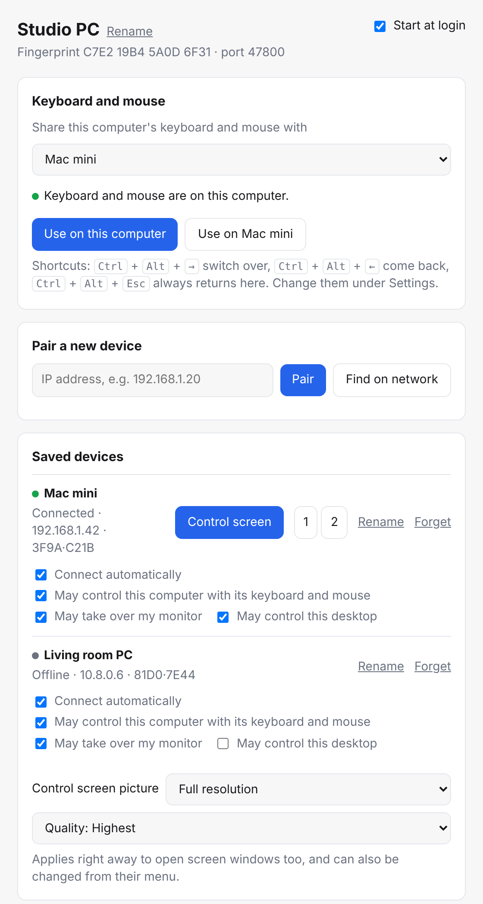

# DisplayAnything

Use your own computers together over your own network: see and control one computer's screen from another, share one keyboard and mouse between them, and copy on one and paste on the other. Windows and macOS today, with an iPhone and iPad viewer on the way.

- **Entirely local.** Your computers connect straight to each other by IP address. There is no account, no sign-in, no cloud server and no relay in the middle. The picture, your keystrokes and your clipboard never leave your network.
- **No internet needed.** Once it's installed, DisplayAnything never contacts the internet. It keeps working with the internet unplugged, as long as the computers can reach each other.
- **Works over a VPN.** If your VPN gives your devices private addresses (most home and office VPNs, such as WireGuard or OpenVPN, do), you can pair and connect across it just like on your home network. See [Using it over a VPN](#using-it-over-a-vpn) for the details.
- **Completely free.** No subscription, no trial, no paid tier, no ads. The code is right here, under the MIT licence.



*The main window (sample devices). It lives in the system tray (Windows) or the menu bar (Mac).*

## What it does today

These features are merged and working on Windows and macOS, in either direction (a PC controlling a Mac, or a Mac controlling a PC).

### Remote screen control

Open another computer's screen in a window on this one, and use it with your own keyboard and mouse.

- **Control screen** next to a connected device opens its screen in a native window, using hardware H.264 encoding on the computer being viewed and hardware decoding on yours.
- **Monitor picker:** if the other computer has more than one monitor, numbered buttons (1, 2, …) pick which one you see, and switch an open window to it.
- **Picture size:** full resolution, match the screen you're watching on, or a fixed size from 4K (3840 x 2160) down to 1280 x 720. The remote picture is scaled to fit and keeps its shape. When you pick a size that isn't the other computer's own, it switches its display to that resolution for the session and puts it back afterwards.
- **Quality:** Highest (the default, about 80 Mbit/s), High, Medium or Low (about 8 Mbit/s) for slower networks.
- Both settings apply right away, including to windows that are already open, from the main window or from the viewer window's menu.
- Keys go to the other computer while its window is in front. **Ctrl+Alt+Esc** (Ctrl+Option+Esc on a Mac) ends control.
- The computer being controlled must allow it first: under **Saved devices**, tick "May control this desktop" for the computer that will view it (off by default). Its tray icon turns green while it's being controlled.
- Keyboard and mouse sharing pauses while a screen is being controlled, so the two never fight.

### Shared keyboard and mouse

One keyboard and mouse for two computers. Pick the other computer under **Keyboard and mouse**, then switch with a shortcut, the buttons in the window, or the tray menu.

| Shortcut (Windows) | Shortcut (Mac) | Does |
| --- | --- | --- |
| Ctrl+Alt+→ | Ctrl+Option+→ | Send keyboard and mouse to the other computer |
| Ctrl+Alt+← | Ctrl+Option+← | Bring them back |
| Ctrl+Alt+Esc | Ctrl+Option+Esc | Always bring them back, even if the link is broken |

- **Your own shortcuts:** under **Settings › Shortcuts**, click **Change** and hold any keys and/or mouse buttons (for example Ctrl + Mouse Back) for 2 seconds. Using the same combination for both directions makes it a toggle.
- **Edge crossing:** a switching mode of its own. Under **Settings › How to switch**, say which side the other computer is on, then push the pointer past that edge of your screen and carry on onto the other computer at the same height. It won't cross while you're dragging something, and Ctrl+Alt+L (changeable) pauses it for games or presenting. In this mode the switch shortcuts and buttons are off; the "always come back" shortcut still works.
- **Mac and PC keys:** on a Mac being used from a PC keyboard, Ctrl and the Windows key are swapped so Ctrl+C copies and Ctrl+Space opens Spotlight. Turn this off under **Settings › Keys** on the Mac.
- **Pointer speed** for the controlled computer is adjustable under **Settings › Keys**; display scaling is already accounted for.
- The tray icon turns green with a check mark on both computers while one is actually controlling the other.
- The receiving computer must allow it: "May control this computer with its keyboard and mouse" under **Saved devices** (on by default).

### Shared clipboard

When your keyboard and mouse move to the other computer, the clipboard goes with them, so you can copy on one and paste on the other.

- **Text**, **images** (up to 16 MB, sent as PNG) and **files** (up to 100 MB in total per copy) are supported.
- Copied files arrive in a temporary folder on the other computer and paste like normal files in Explorer or Finder. The last 5 batches are kept.
- The clipboard is shared through keyboard and mouse sharing, not through a remote screen window.

### Pairing, tray and start-up

- **Pair once with a code:** type the other computer's IP address and click **Pair** (or **Find on network** to look for it). The other computer shows a 6-digit code; type it in, and you're done.
- **Saved devices reconnect on their own** whenever both are running, including after a reboot or an IP address change on the same network.
- **Start at login** is a checkbox at the top of the window.
- **Names:** click this computer's name to rename it. **Rename** next to a saved device sets what it's called on this computer only.
- **Tray menu:** open the window, switch the keyboard and mouse over or back, or quit.
- **Command-line agent** (`da-agent`) for headless machines, scripting and testing.

## iPhone and iPad (in progress)

A free iPhone and iPad app that shows and controls a computer's screen. It is a viewer only: it doesn't share keyboard and mouse or edge crossing.

**Not on `main` yet.** Milestone 1 is in pull request #6 and is being tested:

- Pair with a computer by typing its IP address and the 6-digit code it shows.
- View the computer's screen live.
- Pinch to zoom and drag to pan (on the device, with no delay), double-tap to reset.
- Saved computers are listed so you can reconnect with one tap. The computer saves the phone as view-only and never dials it on its own.

**Being built on the same branch:** touch control of the pointer (trackpad style by default, with a switch to direct touch), clicks and scrolling, and keyboard input including iPad hardware keyboards. These aren't finished, so they aren't described as working here.

The app needs iOS 17 or later. Until it's on the App Store, you build it yourself on a Mac with Xcode. A free Apple ID is enough, though Apple makes free-account installs expire after 7 days, so you reinstall it from Xcode once a week. The computer you view must have "May control this desktop" ticked for the phone.

## What's planned

- **Display takeover:** use another computer's monitor as an extra display for this one. Not built yet. (The "May take over my monitor" checkbox in the window is there for it, and does nothing today.)

## Install

Builds are produced for every change by GitHub Actions (the **CI** workflow): download `DisplayAnything-Windows` (an `.exe` installer plus `da-agent.exe`) or `DisplayAnything-macOS` (`DisplayAnything-macOS.zip` plus the agent) from a run's artifacts. Downloading needs the internet once; running it doesn't.

**Windows:** run the installer. Windows asks once whether to allow it through the firewall; allow it on private networks.

**macOS:** no driver or paid Apple account is needed. Download the build, then run:

```sh
bash scripts/DisplayAnythingInstall.sh ~/Downloads/DisplayAnything-macOS.zip
```

With no argument it uses the newest DisplayAnything download in `~/Downloads`. It quits the running copy, installs the app into Applications, clears the quarantine flag, re-signs it locally, and resets the Accessibility, Input Monitoring and Screen Recording grants (every new build counts as a new app, so old grants silently stop working). Then it opens the app and the Settings pages where you switch them back on:

- **Accessibility** (and Input Monitoring) for keyboard and mouse sharing. If the mouse works but the keyboard doesn't, one of these is missing.
- **Screen Recording** on a Mac whose screen you want to view from another computer.

### Build it yourself

Needs Rust (stable) from https://rustup.rs. On Windows, also the "Desktop development with C++" workload from Visual Studio Build Tools.

```sh
cargo test --workspace          # run the tests
cargo run -p da-tray            # run the tray app
cargo run -p da-agent -- --help # command-line agent
```

For installers, install the Tauri CLI once with `cargo install tauri-cli --version "^2"`, then run `cargo tauri build` in `apps/tray/src-tauri`.

## Try it with two computers

1. Install and start DisplayAnything on both. They must be able to reach each other (same network, or a VPN as below), and TCP port 47800 must be allowed through the firewall.
2. On computer A, type computer B's IP address (shown in its own window, or use **Find on network**) and click **Pair**. Computer B shows a 6-digit code; type it on A.
3. That's it. They connect automatically from now on.

With the CLI: `da-agent serve` on B, `da-agent pair 192.168.1.20` on A, then `da-agent connect 192.168.1.20` to check the link and its latency.

## Local only, and no internet

DisplayAnything is built to run on your network and nowhere else.

- The app connects only to the IP addresses of your own paired computers, on TCP port 47800. It contains no update checks, analytics, crash reporting, licence checks or cloud services, and its window loads nothing from the web (its content security policy allows only the app's own files).
- **Find on network** and automatic reconnection after an IP change use mDNS (Bonjour), which only talks to devices on your local network.
- Connections from addresses that aren't private (anything that could come from the internet) are refused by default, so even a router port-forward can't expose it.
- Everything a computer knows about its paired devices is stored on that computer.

## Using it over a VPN

DisplayAnything doesn't care how two computers reach each other, only that the address is private. It accepts the private address ranges:

- IPv4: `10.x.x.x`, `172.16.x.x` to `172.31.x.x`, `192.168.x.x`, plus link-local `169.254.x.x`
- IPv6: unique local `fc00::/7` and link-local `fe80::/10`

So over a VPN that hands out addresses in those ranges (WireGuard and OpenVPN setups, most router and office VPNs, ZeroTier's usual ranges), you pair and connect exactly as at home: use the other computer's VPN address. Things to know:

- **Find on network won't see across most VPNs**, because mDNS stays on the local network. Type the VPN address instead. The app remembers it and reconnects on its own.
- **Tailscale doesn't work out of the box.** Tailscale's IPv4 addresses (`100.64.x.x` to `100.127.x.x`) aren't in the private ranges, so the app refuses them, and the desktop app currently listens on IPv4 only, so Tailscale's IPv6 addresses can't be used either. The command-line agent can accept them with `da-agent serve --allow-public`, but the tray app has no such setting yet.
- **iPhone and iPad:** the app follows the same rule. On your home Wi-Fi it reaches your computers directly. Away from home, turn on a VPN on the phone (for example the WireGuard app) that gives it a private address, and type the computer's VPN address. iOS asks once for Local Network access; allow it.
- Over a slower VPN link, lower **Quality** and the picture size in **Control screen picture**.

## Security

Every connection is mutual TLS 1.3 with certificates pinned when you pair. Pairing uses SPAKE2 bound to the TLS session, so the code can't be guessed offline, and pairing locks for 10 minutes after 5 wrong codes. Remote screen control is off for each device until you allow it.

## Troubleshooting

The app keeps a log (`da.log` in its data folder; **Show log file** at the bottom of the window), which you can switch off under **Settings › Troubleshooting**. The window footer shows the build, so you can check both computers run the same one.

Known limits:

- Windows won't let a normal app send input to admin windows or UAC prompts. Run DisplayAnything as administrator if you need that.
- On Windows, while one of DisplayAnything's own windows is in front, Windows hands keys straight to it and the keyboard hook can't see them. The app moves focus to the taskbar when you switch over, and a watchdog reinstalls the hook if it misses keys, but shortcuts still don't fire while you're typing in its window.

## Layout

| Path | What it is |
| --- | --- |
| `crates/da-core` | Identity, pairing, trust store, TLS connections, discovery, auto-reconnect, remote control sessions |
| `crates/da-input` | Keyboard and mouse capture and injection (Windows, macOS), key mapping, switching, clipboard |
| `crates/da-screen` | Screen capture, hardware H.264 encode and decode, the native viewer window |
| `crates/da-agent` | Command-line agent |
| `apps/tray` | Tauri tray app: `src-tauri` (Rust) and `ui` (plain HTML and JS, no build step) |
| `scripts/DisplayAnythingInstall.sh` | macOS install and permissions helper |

The iPhone and iPad app (`apps/ios`, `crates/da-mobile`) arrives with pull request #6.
